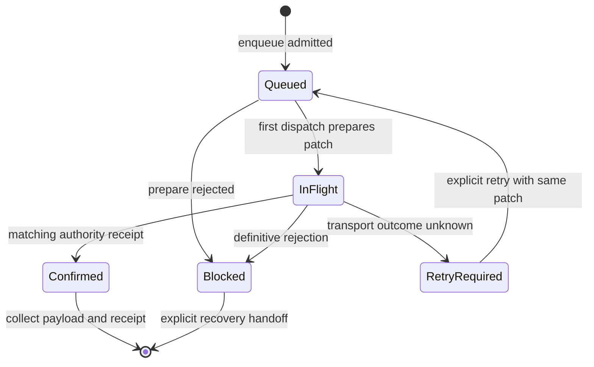

# ADR-0003：完成笔的提交所有权与重试

状态：D3/C1候选，2026-10-14。当前为单所有者参考模型，没有线程调度、磁盘或资源lease；不冻结生产API。

## 目标与边界

InputReplaySession在UP产生CompletedInput；宿主赋予稳定CommandId/ObjectId后，把StrokeSubmission交给文档级StrokeSubmissionQueue。队列不属于某个View或输入会话，session.close只能取消未完成笔。只有enqueue返回Admitted，宿主才把“后续处理责任”交给队列；拒绝时完整输出仍由宿主保留并显示未提交，不得重开新笔后遗忘。

重复enqueue相同ID/完整payload返回现有状态，不增加预算；相同ID不同payload拒绝。该去重只覆盖队列仍保留的条目，不是无限历史去重。collect后宿主负责ID/receipt台账，文档authority负责已接受命令的幂等；当前内存journal仅有计数上限，不是生产持久化台账。

## 状态与操作

严格FIFO，只有一个in-flight。Confirmed不阻塞下一笔；Blocked/RetryRequired阻塞后续未确认笔，避免失败后悄悄改变笔画顺序。首派发从authority快照取得baseRevision并prepare，继续使用DOWN捕获的scene/layer/brush。外部文档修订导致STALE_SCENE时明确Blocked，不自动rebase；需要宿主重新协调，不能把所有命令都当可安全重放的Add。

stopAccepting只停止新入队，队列继续drain已拥有工作；没有clear/drop API。collectConfirmed明确向宿主交还完整proposal与receipt；collectBlocked明确交还完整proposal与失败原因。in-flight/未知提交结果不能被collectBlocked释放。宿主必须接住返回值；reference无法阻止宿主自己丢掉对象，生产handoff协议还需强制调度与跨线程所有权验证。

## 未知结果与迟到回执

transportFailed不是“命令未执行”的证据：后端可能已经commit但回执丢失。因此保留**原patch、原baseRevision、原CommandId及完整payload**，显式retry后发送同一patch；禁止对已变化Scene重新prepare同一ID。这避免D1 Reducer因对象已存在而拒绝重试，也让authority返回原receipt而不增加场景revision。

每次dispatch返回不透明attempt对象与递增序号。回调必须匹配该队列的当前attempt身份；旧重试、重复回调、跨队列同ID回调均返回STALE_ATTEMPT。Accepted receipt必须匹配CommandId和patch.baseRevision+1，否则INVALID_RECEIPT且仍在途；调用方应调查或显式报告transport failure，不能释放预算。

这里假定authority提供可信CommitResult：Rejected明确未应用这次proposal；Accepted与实际patch对应。该模型不会从一段回执文字证明磁盘或后端真实性。生产未知事务结果需要查询/恢复协议与持久化命令台账，未来后端不能用普通Rejected冒充未知结果。

## 预算与确认含义

默认64条、8MiB逻辑charge，两个限额均检查。真实点payload按28字节/点（double x/y、float pressure、long time）加256字节参考元数据及ID字符串长度计费；加法使用剩余预算比较，不以驱逐旧笔腾空间。Queued、InFlight、RetryRequired、Blocked和**未collect的Confirmed**全部继续计费，回执到达不自动把已保留payload变成零成本。

charge是确定性入队单位，不是测量后的实际堆内存上限。Snapshot/journal、临时patch、调用方引用、队列对象头、GPU/in-flight/native资源另有成本；生产需要点arena/字节所有权和全局预算，再做平台测量。当前链路的Confirmed只代表authority接受，receipt仍为MEMORY_ONLY，UI不得显示为“已保存”。未来durable状态必须有真实存储确认与恢复证据后再接入。

## 验证与后续

公共测试覆盖计数/字节满、相同ID幂等/冲突、首派发base与captured layer、单in-flight、执行前失败、执行后丢ACK、迟到/重复/跨队列回调、错误receipt、journal满、STALE_SCENE、输入关闭、显式回收与恢复交接。它们按指定顺序调用同线程模型，属于强制顺序反例，不是并发竞态或真机背压测试。

下一节点增加resource lease假后端：resident与borrowed/in-flight总字节、驱逐仍有读者、detach后GPU延迟完成、资源释放线程绑定；然后引入可控调度器与提交/关闭交错。失败handoff、异步队列、持久化台账与document关闭仍是C1未决，不能由本轮单线程参考模型宣称完整D3通过。
