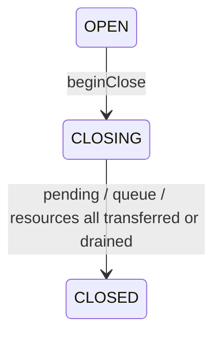

# ADR-0008：文档关闭与恢复责任交接

2026-10-14；D3/C1候选。DocumentCloseCoordinator是公共单owner参考模型，组合既有输入、提交FIFO、frame gate和resource lease，不是跨线程执行器、正式持久化恢复或原生GPU实现。

## 所有者和关闭条件

文档协调器私有拥有一条提交队列、一个资源池与有限session。session只拥有输入累积与frame gate；文档权威仍由外部唯一authority提供snapshot/commit结果，关闭不会创建第二份Scene。UI退出与文档关闭不同：closeSession取消未完成输入、报告取消真实采样数、禁止迟到frame，但已经完成的笔仍留在pending槽；同一个活文档仍可接收入队。

beginClose是不可逆、幂等的单owner转移：停止所有session输入/呈现，停止新队列准入，关闭资源池的reserve/borrow。已有提交、迟到分配、最后读者/fence、释放与查询结果仍由该owner处理，没有clear、shutdownNow或“关闭即清空预算”。

CLOSED必须同时满足：所有session pending已接管，提交条目（包括Confirmed/Blocked）已交接，资源池isDrained。仅“提交线程空闲”、release已发出、GPU析构但ACK尚未处理或UI detached都不能完成关闭。

协调器记录已观察到的authority修订下限：有效提交回执与派发snapshot会推进它，宿主处理外部修订后也应调用observeScene。即使frame gate尚未更新expected，低于该下限的frame/session也不能发布/建立；旧或foreign snapshot不能回退下限。该记录不是第二个可变Scene，也不会证明尚未观察到的外部变化。status给出pending、input reservation、提交状态/charge、资源reservation/读者/释放在途/未知handle/待释放数；宿主必须保留owner到CLOSED，没有超时丢弃捷径。

## 完成笔与有界准入

consume在UP后立即将CompletedInput保留在session唯一pending槽，下一笔在它入队或交接前显式拒绝。submitPending第一次赋予稳定CommandId/ObjectId，容量拒绝后保留完整数据、ID和原因；重试不能更换身份。仅Admitted/Existing相同完整proposal才移交队列并清槽。closeSession后尚可向活文档提交；beginClose后未入队内容改走显式恢复交接，不在关闭时偷偷扩大队列容量。

默认session元数据上限8、输入逻辑reservation预算8MiB；openSession按maxRealSamples×28+256预留，超限在输入建立前拒绝。关闭且无pending才归还reservation；关闭时pending尚未交接继续计费。提交沿用64条/8MiB逻辑charge，资源沿用resident4MiB/total8MiB及资源/lease元数据上限。这些是分域参考准入单位，不是实际总堆/GPU硬内存上限；生产仍需arena、临时patch/编码峰值、真实平台计费和全局调度预算。

## 两步恢复交接

offerPending只对已关闭session提供完整完成笔、可选已赋值proposal和最后准入失败原因。offerSubmission仅对Confirmed或确定Blocked提供完整proposal及receipt/reason。重复offer返回同一capability。提供/查看内容不改变所有权、条目或charge。

接收方先保留payload/恢复责任，再acknowledge原offer，协调器才清除其内部责任并归还相应charge。foreign/重复/已完成offer不能再次回收；ack后offer不再保留payload，裸Session/offer ownership tag不保留整个owner。此协议只能证明显式责任转移，不能证明宿主之后没有丢数据，更不表示接收方已落盘。生产接管必须增加实际ledger/存储ACK；进程退出前仍需durable证据。

在途或RetryRequired（提交结果未知）不允许当作确定失败交出并结束关闭。transportFailed后继续持有原patch，retry派发同一patch/CommandId/base，迟到attempt拒绝，authority幂等返回原receipt。Confirmed仍是MEMORY_ONLY，不能显示为“已保存”。

资源UNKNOWN与提交未知不同：释放后ACK丢失可能已经析构，不能自动重放free。unknown handle保留charge并隔离，后端查询确定RELEASED或NOT_RELEASED后才能继续；尚未分配reservation只能经明确cancelUnallocated归还。逻辑lane不证明平台线程，FakeGpuResource不是真实GPU fence。

## 验证与落地边界

15项新公共反例覆盖：空/重复关闭、取消报告与迟到frame、未提交完成笔、容量拒绝的稳定ID、session退出后入队、恢复offer不释放/foreign与重复ACK、执行后丢ACK原patch重放、确定失败交接、迟到分配、未知析构/不double-free、未分配取消、输入预算/foreign session、提交后的旧帧拒绝、外部修订观察与提交/关闭/fence/接管任务交错。所有调度是单真实线程上的可控逻辑lane，不是并发内存模型证明。

当前预览App继续使用自己的同步内存authority和平台文件保存，原生CPU Path由系统管理；本轮不将假GPU池硬塞进View，也不把这个参考协调器冒充App已有的崩溃恢复。新增核心会重新编译双端包并回归Android现有流程。下一节点定义真实owner执行器/跨线程结果与有界投递，随后验证正式存储恢复与分页域；C1及D3整体仍未冻结。
